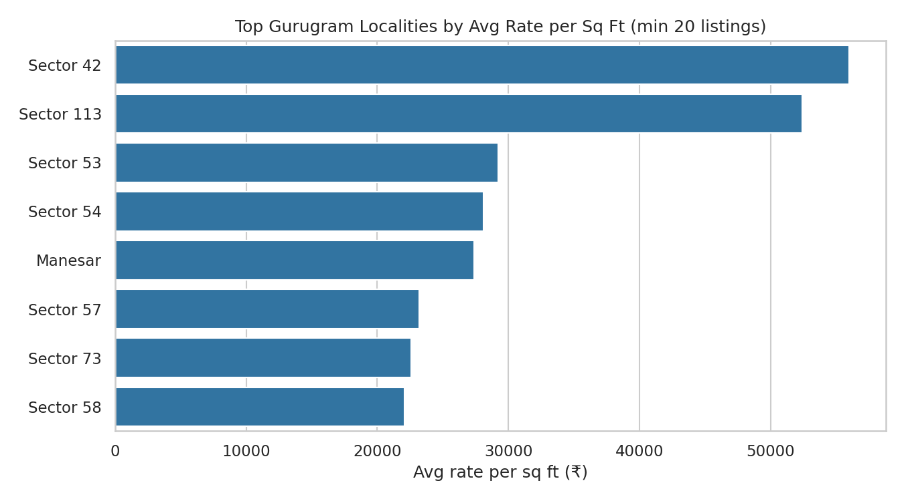
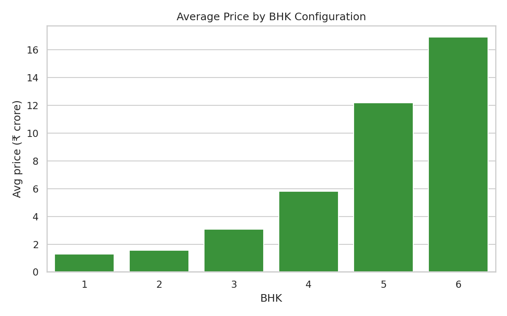
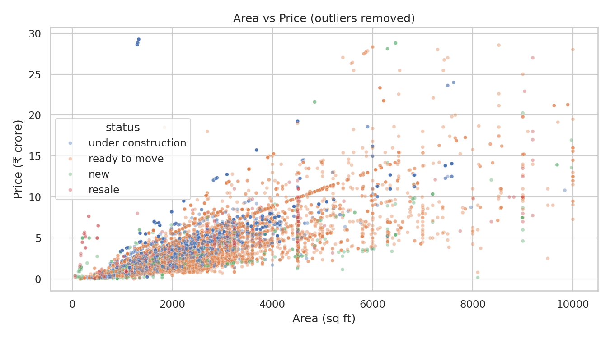

# Gurugram Real Estate Data Analysis

Exploratory data analysis (EDA) of Gurugram property listings to understand what drives housing prices in the city, built with Python.

## Overview
This project cleans a raw real estate dataset (19,515 listings → 14,223 after removing duplicates) and answers key questions about prices, localities, property status, RERA approval and BHK configurations using Pandas and Seaborn.

## Data Cleaning
- Standardized column names (lowercase, underscores)
- Removed 5,292 duplicate records
- Converted `price`, `area` and `rate_per_sqft` from text to numeric
- Cleaned `status`, `flat_type` and `rera_approval` (mapped to True/False)

## Key Findings
- **Most expensive listing:** a 6 BHK apartment in DLF Camellias, Sector 42 — 16,500 sq ft at ₹74,323/sq ft, priced at about ₹122.6 crore.
- **Highest average price:** Sector 42 (about ₹50 crore average, among localities with 20+ listings).
- **Highest rate per sq ft:** Sector 42 (about ₹55,989/sq ft), followed by Sector 113 (about ₹52,404/sq ft).
- **Ready-to-move vs under construction:** ready-to-move listings cost slightly more on average (about ₹4.15 crore vs ₹3.96 crore), but under-construction listings have a higher rate per sq ft (about ₹17,802 vs ₹13,550).
- **RERA approval:** RERA-approved listings do not have a higher average total price (about ₹3.86 crore vs ₹4.08 crore), but they have a higher average rate per sq ft (about ₹17,645 vs ₹13,837).
- **Area vs price:** the correlation is weak (about 0.20), and area has almost no correlation with rate per sq ft, so larger homes are not more expensive per sq ft.
- **BHK:** average price rises steadily from about ₹1.3 crore (1 BHK) to about ₹16.9 crore (6 BHK).

## Charts




## Tools Used
Python, Pandas, NumPy, Matplotlib, Seaborn, Jupyter Notebook

## How to Run
```bash
git clone https://github.com/<your-username>/gurugram-real-estate-analysis.git
cd gurugram-real-estate-analysis
pip install pandas numpy matplotlib seaborn jupyter
jupyter notebook gurugram_real_state.ipynb
```

## Author
**Akshay Kumar**
